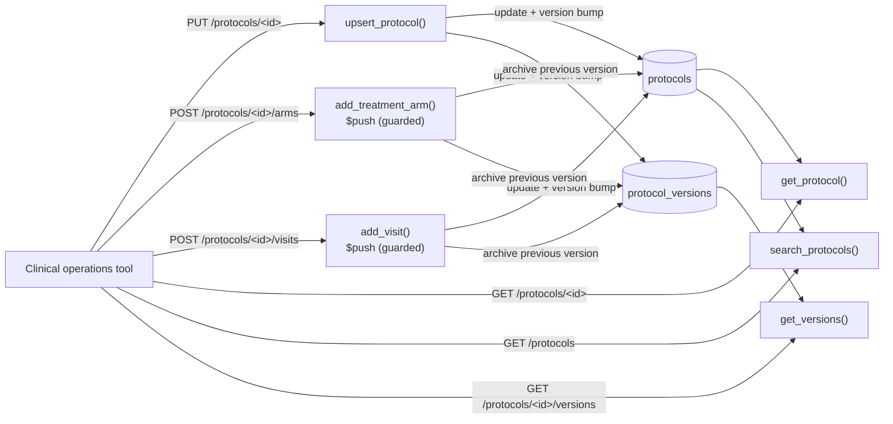

# Clinical Trial Protocol

## Overview

A minimal example of modeling **clinical trial protocol / research design metadata** on [Amazon DocumentDB](https://docs.aws.amazon.com/documentdb/latest/devguide/what-is.html) using Python and Flask. Each document describes how a trial is designed (its phase, treatment arms, visit schedule, eligibility criteria, and endpoints), the kind of sponsor-side configuration defined before any subject is enrolled. This data is hierarchical, read-mostly, and varies between trials - well suited for the document model.

> **Scope.** This sample contains no subject data, only trial design metadata, and data is fictional. It is not a system of record for regulated protocols: it serves protocol metadata to applications, and its amendment history illustrates a data-modeling pattern, not a validated audit trail. The sample has no authentication.

**Key design elements**

- One document per protocol with a flexible schema for trial design metadata
- Amendment history - each change bumps a `version` with one `find_one_and_update` that returns the document as it was before*the change; the prior state is then inserted into the `protocol_versions` collection
- Bounded nested arrays: `treatment_arms` and `visit_schedule` are appended with `$push`, only if the name is not already present and the cap is not reached, with both conditions in the update filter, so a repeated request is rejected rather than duplicated
- Validated, allowlisted writes (phase, status, and nested structures are checked before they reach the database)
- A compound index for the filters the search endpoint accepts, plus a unique index per protocol and per version
- Bounded, paged search (`limit` max 100, `?after=` cursor). The compound index serves any left-to-right prefix of `therapeutic_area`, `phase`, `status`; `phase` and `status` each also have their own index

### How the data flows



## Schema

**`protocols`** (current design):

```json
{
  "protocol_id": "ct-2031",
  "title": "A Phase II Study of Compound XJ-14 in Moderate Persistent Asthma",
  "phase": "II",
  "therapeutic_area": "respiratory",
  "sponsor": "Example Therapeutics",
  "status": "recruiting",
  "treatment_arms": [
    { "arm_name": "Arm A - Active", "intervention": "XJ-14 200mg", "dosing_schedule": "Once daily, oral, 12 weeks" },
    { "arm_name": "Arm B - Placebo", "intervention": "Placebo", "dosing_schedule": "Once daily, oral, 12 weeks" }
  ],
  "visit_schedule": [
    { "visit_name": "Screening", "study_day": -14, "window_days": 7, "procedures": ["informed consent", "spirometry", "blood draw"] },
    { "visit_name": "Baseline", "study_day": 0, "window_days": 1, "procedures": ["randomization", "spirometry"] }
  ],
  "inclusion_criteria": [ "Age 18-65 years", "Confirmed diagnosis of moderate persistent asthma" ],
  "exclusion_criteria": [ "Current smoker or history of smoking within 1 year" ],
  "primary_endpoints": [ "Change in FEV1 from baseline at week 12" ],
  "secondary_endpoints": [ "Rate of asthma exacerbations during treatment period" ],
  "version": 1,
  "updatedAt": "Wed, 28 Oct 2026 16:00:00 GMT"
}
```

**`protocol_versions`** (one document per superseded version):

```json
{ "protocol_id": "ct-2031", "version": 1, "snapshot": { "...": "full protocol as of version 1" }, "archivedAt": "Wed, 28 Oct 2026 16:05:00 GMT" }
```

`updatedAt` and `archivedAt` are stored as BSON dates and shown here as the API returns them.

Allowed values: `phase` is one of `I`, `I/II`, `II`, `II/III`, `III`, `IV`; `status` is one of `not_yet_recruiting`, `recruiting`, `active_not_recruiting`, `completed`, `suspended`, `terminated`, `withdrawn`.

## API Endpoints

| Method | Path | Description |
| --- | --- | --- |
| `PUT` | `/protocols/<protocol_id>` | Create or update design metadata (validated, allowlisted); each update is a new version |
| `GET` | `/protocols/<protocol_id>` | Return the current protocol (visits sorted by `study_day`) |
| `GET` | `/protocols/<protocol_id>/versions` | Amendment history, newest first (`?limit=`, max 50) |
| `GET` | `/protocols` | Search by `therapeutic_area` / `phase` / `status` (`?limit=` max 100, `?after=<protocol_id>`) |
| `POST` | `/protocols/<protocol_id>/arms` | Add a treatment arm (`409` if the name exists or the cap is reached) |
| `POST` | `/protocols/<protocol_id>/visits` | Add a visit (`409` if the name exists or the cap is reached) |

## Prerequisites

- Python 3.10+
- Amazon DocumentDB cluster
- Amazon DocumentDB CA certificate:

```bash
wget https://truststore.pki.rds.amazonaws.com/global/global-bundle.pem
```

## Installation

```bash
pip install -r requirements.txt
```

## Configuration

Set the following environment variable before running:

| Variable | Required | Default | Description |
| --- | --- | --- | --- |
| `DOCDB_URI` | Y | — | Cluster connection string from the Amazon DocumentDB console |
| `FLASK_HOST` | N | `127.0.0.1` | Interface to bind. Leave as is unless you add authentication |
| `FLASK_DEBUG` | N | `0` | `1` enables the Flask debugger (local development only) |
| `SEED_COUNT` | N | `500` | Total protocols after first-run seeding (hand-written plus generated) |

**Linux/macOS:**

```bash
export DOCDB_URI="mongodb://<user>:<pass>@your-cluster.cluster-xxxx.us-east-1.docdb.amazonaws.com:27017/?tls=true&tlsCAFile=global-bundle.pem&replicaSet=rs0&readPreference=secondaryPreferred&retryWrites=false"
```

**Windows PowerShell:**

```powershell
$env:DOCDB_URI="mongodb://<user>:<pass>@your-cluster.cluster-xxxx.us-east-1.docdb.amazonaws.com:27017/?tls=true&tlsCAFile=global-bundle.pem&replicaSet=rs0&readPreference=secondaryPreferred&retryWrites=false"
```

> Environment variables are convenient for a sample but are not how credentials should be handled in production. Use [AWS Secrets Manager](https://docs.aws.amazon.com/documentdb/latest/developerguide/docdb-secrets-manager.html) and load the connection details at startup.

## Running the Sample

```bash
python app.py
```

On first run the app creates indexes and, if the collection is empty, loads the hand-written records in `seed_data.json` and then generates additional sample protocols up to `SEED_COUNT` in total, then serves on `http://127.0.0.1:5000`. Generated data comes from a fixed PRNG seed, so every run produces identical data, and it gives indexes and bounded queries realistic volumes to work against.

**Expected output:**

```
[INFO] __main__ – Connected to DocumentDB
[INFO] __main__ – Indexes ensured.
[INFO] __main__ – Inserted 500 sample protocols
[INFO] __main__ – Starting web interface on http://127.0.0.1:5000
```

### Try it

```bash
# Search recruiting respiratory trials
curl -s "http://127.0.0.1:5000/protocols?therapeutic_area=respiratory&status=recruiting" | python -m json.tool

# Add a treatment arm (amendment). Send it twice: the second call returns 409
curl -s -X POST http://127.0.0.1:5000/protocols/ct-2031/arms \
  -H "Content-Type: application/json" \
  -d '{"arm_name":"Arm C - Low dose","intervention":"XJ-14 100mg","dosing_schedule":"Once daily, oral, 12 weeks"}'

# Change status (a new version; the previous state is archived)
curl -s -X PUT http://127.0.0.1:5000/protocols/ct-2031 \
  -H "Content-Type: application/json" -d '{"status":"active_not_recruiting"}'

# Read the amendment history
curl -s "http://127.0.0.1:5000/protocols/ct-2031/versions" | python -m json.tool

# Invalid input is rejected (400)
curl -s -X PUT http://127.0.0.1:5000/protocols/ct-2031 \
  -H "Content-Type: application/json" -d '{"phase":"V"}'
```

## Cleanup

```bash
python app.py --cleanup
```

Drops the `protocols` and `protocol_versions` collections.

## Code Structure

```
.
├── app.py              # Flask application + DocumentDB access
├── seed_data.json      # Hand-written sample documents (more are generated on first run)
├── requirements.txt    # Python dependencies
├── .gitignore          # Ignored files
└── README.md           # This file
```

## Anti-Patterns to avoid

| Anti-Pattern | Why It's Harmful | Correct Approach |
| --- | --- | --- |
| `tlsAllowInvalidCertificates=True` | Disables certificate validation | Always validate against the CA bundle (`tlsCAFile`) |
| Hardcoded credentials | Breaks rotation; leaks via source control | Secrets Manager for production |
| Overwriting a protocol with no history | Loses what the design said at a point in time | Version each change and archive the previous state |
| Unbounded `treatment_arms` / `visit_schedule` growth | Document grows without limit across amendments | Cap the arrays in the update filter; archive history in its own collection |
| `$push` without a uniqueness check | A retried request adds the same arm or visit twice | Put "name not present" in the update filter |
| Building search queries from arbitrary request parameters | Callers can filter or scan on any field | Allowlist query fields; bound results with `.limit()` and page with a cursor |

## Resources

- [Amazon DocumentDB Developer Guide](https://docs.aws.amazon.com/documentdb/latest/developerguide/what-is.html)
- [DocumentDB indexing and query best practices](https://docs.aws.amazon.com/documentdb/latest/developerguide/best-practices.html)
- [AWS Well-Architected Framework](https://aws.amazon.com/architecture/well-architected/)

## Disclaimer

This sample is provided for demonstration purposes and is not intended for production use as-is. It contains no patient or subject data. Review the security, networking, and operational configuration against your own requirements before deploying.
