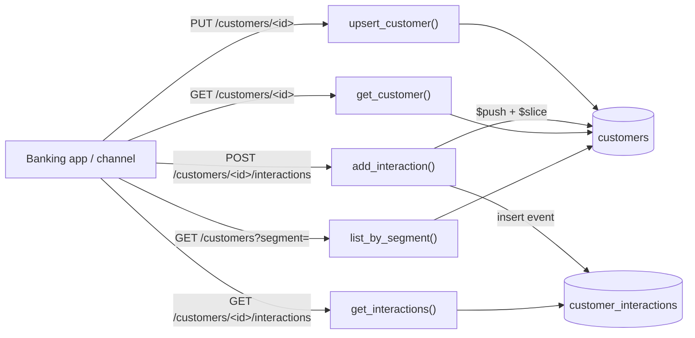

# Customer 360 Profile

## Overview

A minimal example of serving a unified customer profile from [Amazon DocumentDB](https://docs.aws.amazon.com/documentdb/latest/devguide/what-is.html) using Python and Flask. Accounts, preferences, segments, KYC (know your customer) state, and recent interactions live in one document per customer, so a channel can load a consolidated view with a single key lookup.

The profile contains a projection of upstream systems of record such as core banking, KYC, and CRM. It stores account references only, with no balances, transactions, or credentials.

> **Scope.** All data is fictional and the sample has no authentication. If you store real PII or KYC attributes, protect those fields with [client-side field level encryption](https://docs.aws.amazon.com/documentdb/latest/developerguide/field-level-encryption.html).

**Key design elements**

- One profile document per customer consolidating many source systems
- Bounded `recentInteractions` array (`$push` + `$slice`, last 50) inside the profile (full history lives in a separate `customer_interactions` collection)
- `kyc` cannot be set through the profile API, because it is owned by the KYC system of record
- Per-channel projections (`?fields=`) so each channel reads only what it needs
- Bounded segment lookup (`GET /customers?segment=`) backed by a multikey index
- Profile upsert with `update_one(..., upsert=True)`, so repeating the same `PUT` leaves the same document

### How the data flows



## Schema

**`customers`** (one document per customer, bounded size):

```json
{
  "customerId": "c-5523",
  "displayName": "Sample Customer A",
  "accounts": [ { "type": "checking", "id": "chk-01" } ],
  "recentInteractions": [
    { "channel": "app", "action": "login", "ts": "Thu, 01 Oct 2026 09:30:00 GMT" }
  ],
  "preferences": { "channel": "app", "language": "en" },
  "segments": [ "wealth", "mobile_first" ],
  "kyc": { "status": "verified", "level": 2 },
  "updatedAt": "Thu, 01 Oct 2026 09:30:00 GMT"
}
```

**`customer_interactions`** (full history, one document per event: `customerId`, `channel`, `action`, `ts`; indexed on `customerId, ts`).

## API Endpoints

| Method | Path | Description |
| --- | --- | --- |
| `PUT` | `/customers/<customerId>` | Create or update allowlisted fields (`displayName`, `accounts`, `preferences`, `segments`) |
| `GET` | `/customers/<customerId>` | Return the profile (`?fields=a,b` selects from an allowlist: `customerId`, `displayName`, `accounts`, `preferences`, `segments`, `recentInteractions`, `updatedAt`; other names return 400) |
| `GET` | `/customers?segment=<name>` | List customers in a segment (max 100) |
| `POST` | `/customers/<customerId>/interactions` | Record an interaction (history insert + capped `$push`) |
| `GET` | `/customers/<customerId>/interactions` | Full history, newest first (`?limit=`, max 200) |

## Prerequisites

- Python 3.10+
- Amazon DocumentDB cluster
- Amazon DocumentDB CA certificate:

```bash
wget https://truststore.pki.rds.amazonaws.com/global/global-bundle.pem
```

## Installation

```bash
pip install -r requirements.txt
```

## Configuration

Set the following environment variable before running:

| Variable | Required | Default | Description |
| --- | --- | --- | --- |
| `DOCDB_URI` | Y | — | Cluster connection string from the Amazon DocumentDB console (includes host, port, credentials, TLS, and read preference). The app refuses to start unless it contains `tls=true` (or `ssl=true`) and a `tlsCAFile`, and it rejects `tlsAllowInvalidCertificates=true`, `tlsInsecure=true`, and any `tls`/`ssl` value other than `true` |
| `DOCDB_TLS_CA` | N | — | Path to the CA bundle, only needed if `tlsCAFile` is not in `DOCDB_URI` |
| `FLASK_HOST` | N | `127.0.0.1` | Interface to bind. Leave as is unless you add authentication |
| `FLASK_DEBUG` | N | `0` | `1` enables the Flask debugger (local development only) |
| `SEED_COUNT` | N | `1000` | Total customers after first-run seeding (hand-written plus generated) |

**Linux/macOS:**

```bash
export DOCDB_URI="mongodb://<user>:<pass>@your-cluster.cluster-xxxx.us-east-1.docdb.amazonaws.com:27017/?tls=true&tlsCAFile=global-bundle.pem&replicaSet=rs0&readPreference=secondaryPreferred&retryWrites=false"
```

**Windows PowerShell:**

```powershell
$env:DOCDB_URI="mongodb://<user>:<pass>@your-cluster.cluster-xxxx.us-east-1.docdb.amazonaws.com:27017/?tls=true&tlsCAFile=global-bundle.pem&replicaSet=rs0&readPreference=secondaryPreferred&retryWrites=false"
```

> Environment variables are convenient for a sample but are not how credentials should be handled in production. Use [AWS Secrets Manager](https://docs.aws.amazon.com/documentdb/latest/developerguide/docdb-secrets-manager.html) and load the connection details at startup.

## Running the Sample

```bash
python app.py
```

On first run the app creates indexes and, if the collection is empty, loads the hand-written records in `seed_data.json` and then generates additional sample customers, each with an interaction history, up to `SEED_COUNT` in total, then serves on `http://127.0.0.1:5000`. Generated data comes from a fixed PRNG seed, so every run produces identical data, and it gives indexes, and bounded queries realistic volumes to work against.

**Expected output:**

```
[INFO] __main__ – Connected to DocumentDB
[INFO] __main__ – Indexes ensured.
[INFO] __main__ – Inserted 1000 sample customers and 14913 interactions
[INFO] __main__ – Starting web interface on http://127.0.0.1:5000
```

### Try it

```bash
# Load a profile, projecting only what a channel needs
curl -s "http://127.0.0.1:5000/customers/c-5523?fields=displayName,segments" | python -m json.tool

# Find customers in a segment
curl -s "http://127.0.0.1:5000/customers?segment=wealth" | python -m json.tool

# Record an interaction (history insert + capped push)
curl -s -X POST http://127.0.0.1:5000/customers/c-5523/interactions \
  -H "Content-Type: application/json" -d '{"channel":"app","action":"view_statement"}'

# Read full history, newest first
curl -s "http://127.0.0.1:5000/customers/c-5523/interactions?limit=10" | python -m json.tool

# kyc is not writable through the profile API (returns 400)
curl -s -X PUT http://127.0.0.1:5000/customers/c-5523 \
  -H "Content-Type: application/json" -d '{"kyc":{"status":"verified"}}'
```

## Cleanup

```bash
python app.py --cleanup
```

Drops the `customers` and `customer_interactions` collections.

## Code Structure

```
.
├── app.py              # Flask application + DocumentDB access
├── seed_data.json      # Hand-written sample documents (more are generated on first run)
├── requirements.txt    # Python dependencies
├── .gitignore          # Ignored files
└── README.md           # This file
```

## Anti-Patterns to Avoid

| Anti-Pattern | Why It's Harmful | Correct Approach |
| --- | --- | --- |
| `tlsAllowInvalidCertificates=True` | Disables certificate validation | Always validate against the CA bundle (`tlsCAFile`) |
| Hardcoded credentials | Breaks rotation; leaks via source control | Environment variables for demos, Secrets Manager for production |
| `retryWrites=True` | Not supported by DocumentDB | Set `retryWrites=False` |
| Unbounded `interactions` array in the profile | Document approaches the 16 MB limit and is rewritten on every push | Keep a capped `recentInteractions` array and store full history in its own collection |
| `$set` of the entire request body | Callers can overwrite any field, including `kyc` | Allowlist writable fields; sync regulated attributes from the system of record |
| Storing balances or transactions in the profile | Stale, inconsistent copies of financial data | Store references only and read balances from the ledger |

## Resources

- [Amazon DocumentDB Developer Guide](https://docs.aws.amazon.com/documentdb/latest/developerguide/what-is.html)
- [DocumentDB indexing and query best practices](https://docs.aws.amazon.com/documentdb/latest/developerguide/best-practices.html)
- [AWS Well-Architected Framework](https://aws.amazon.com/architecture/well-architected/)

## Disclaimer

This sample is provided for demonstration purposes and is not intended for production use as-is. Review the security, networking, and operational configuration against your own requirements before deploying.
