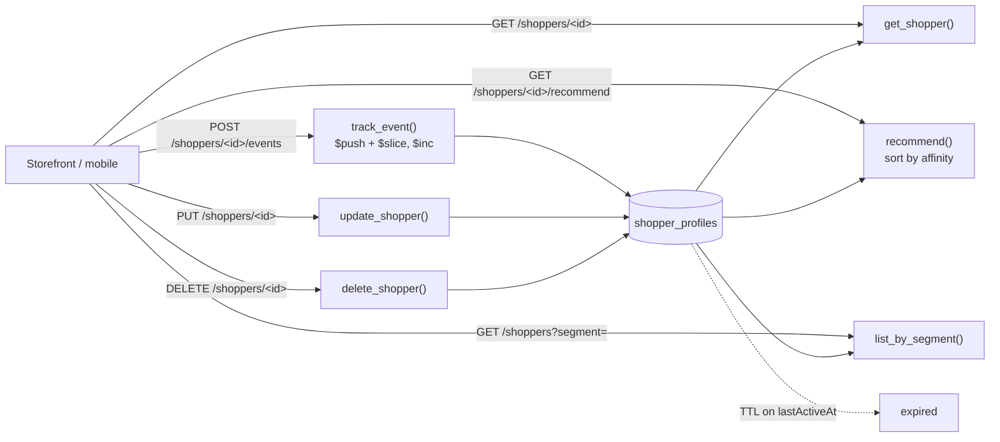

# Personalization Profile

## Overview

A minimal example of modeling a shopper personalization profile on [Amazon DocumentDB](https://docs.aws.amazon.com/documentdb/latest/devguide/what-is.html) using Python and Flask. Each shopper has one evolving document holding recent views, cart, category affinities, preferences, and segments.

The profile serves current behavior and preferences to the storefront and can supply features to a recommendation service such as Amazon Personalize. The `recommend` endpoint is a simple affinity sort, not an ML model.

> **Scope.** All data is fictional and the sample has no authentication.

**Key design elements**

- One evolving document per shopper
- Each event carries an `eventId`; the update filter excludes shoppers that already processed it, so a replay of a recent `eventId` is ignored
- Behavior tracking with a capped `recentViews` array (`$push` + `$slice`) and atomic category affinity counters (`$inc`)
- Allowlisted profile writes (`preferences`, `segments`, `cart`)
- Bounded segment lookup (`GET /shoppers?segment=`) backed by a multikey index
- TTL index on `lastActiveAt` expires inactive profiles, and a delete endpoint supports erasure requests
- Indexes that each back a query or lifecycle rule in the code

### How the data flows



## Document Schema

```json
{
  "shopperId": "s-9087",
  "recentViews": [ "sku-11", "sku-42" ],
  "cart": [ { "sku": "sku-11", "qty": 1 } ],
  "affinities": { "shoes": 12, "outerwear": 5 },
  "preferences": { "size": "M", "brand": "Acme" },
  "segments": [ "frequent", "mobile" ],
  "lastActiveAt": "Wed, 28 Oct 2026 16:00:00 GMT",
  "recentEventIds": [ "evt-0001", "evt-0002" ]
}
```

`lastActiveAt` is stored as a BSON date (shown here as the API returns it); profiles inactive for 180 days are removed by a TTL index. `recentEventIds` is internal bookkeeping for de-duplicating replays (the last 50 IDs) and is not returned by the API. Category names are restricted to `[a-z0-9_-]{1,40}` because they become field names under `affinities`.

## API Endpoints

| Method | Path | Description |
| --- | --- | --- |
| `GET` | `/shoppers/<shopperId>` | Return the shopper profile |
| `PUT` | `/shoppers/<shopperId>` | Create or update `preferences`, `segments`, `cart` |
| `DELETE` | `/shoppers/<shopperId>` | Erase the profile |
| `GET` | `/shoppers?segment=<name>` | List shoppers in a segment (max 100) |
| `POST` | `/shoppers/<shopperId>/events` | Track a view (`eventId`, `sku`, optional `category`); replays of a recent `eventId` are ignored |
| `GET` | `/shoppers/<shopperId>/recommend` | Top 3 affinity categories |

## Prerequisites

- Python 3.10+
- Amazon DocumentDB cluster
- Amazon DocumentDB CA certificate:

```bash
wget https://truststore.pki.rds.amazonaws.com/global/global-bundle.pem
```

## Installation

```bash
pip install -r requirements.txt
```

## Configuration

Set the following environment variable before running:

| Variable | Required | Default | Description |
| --- | --- | --- | --- |
| `DOCDB_URI` | Y | — | Cluster connection string from the Amazon DocumentDB console (includes host, port, credentials, TLS, and read preference) |
| `FLASK_HOST` | N | `127.0.0.1` | Interface to bind. Leave as is unless you add authentication |
| `FLASK_DEBUG` | N | `0` | `1` enables the Flask debugger (local development only) |
| `SEED_COUNT` | N | `2000` | Total shopper profiles after first-run seeding (hand-written plus generated) |

**Linux/macOS:**

```bash
export DOCDB_URI="mongodb://<user>:<pass>@your-cluster.cluster-xxxx.us-east-1.docdb.amazonaws.com:27017/?tls=true&tlsCAFile=global-bundle.pem&replicaSet=rs0&readPreference=secondaryPreferred&retryWrites=false"
```

**Windows PowerShell:**

```powershell
$env:DOCDB_URI="mongodb://<user>:<pass>@your-cluster.cluster-xxxx.us-east-1.docdb.amazonaws.com:27017/?tls=true&tlsCAFile=global-bundle.pem&replicaSet=rs0&readPreference=secondaryPreferred&retryWrites=false"
```

> Environment variables are convenient for a sample but are not how credentials should be handled in production. Use [AWS Secrets Manager](https://docs.aws.amazon.com/documentdb/latest/developerguide/docdb-secrets-manager.html) and load the connection details at startup.

## Running the Sample

```bash
python app.py
```

On first run the app creates indexes and, if the collection is empty, loads the hand-written records in `seed_data.json` and then generates additional sample shoppers up to `SEED_COUNT` in total, then serves on `http://127.0.0.1:5000`. Generated data comes from a fixed PRNG seed, so every run produces identical data, and it gives indexes, and bounded queries realistic volumes to work against.

**Expected output:**

```
[INFO] __main__ – Connected to DocumentDB
[INFO] __main__ – Indexes ensured on collection 'shopper_profiles'.
[INFO] __main__ – Inserted 2000 sample documents
[INFO] __main__ – Starting web interface on http://127.0.0.1:5000
```

### Try it

```bash
# Load a profile
curl -s http://127.0.0.1:5000/shoppers/s-9087 | python -m json.tool

# Track a view. Send it twice: the second call returns "duplicate": true
curl -s -X POST http://127.0.0.1:5000/shoppers/s-9087/events \
  -H "Content-Type: application/json" -d '{"eventId":"evt-0001","sku":"sku-99","category":"shoes"}'

# Top affinity categories
curl -s http://127.0.0.1:5000/shoppers/s-9087/recommend | python -m json.tool

# Shoppers in a segment
curl -s "http://127.0.0.1:5000/shoppers?segment=frequent" | python -m json.tool

# Erase a profile
curl -s -X DELETE http://127.0.0.1:5000/shoppers/s-9120
```

## Cleanup

```bash
python app.py --cleanup
```

Drops the `shopper_profiles` collection.

## Code Structure

```
.
├── app.py              # Flask application + DocumentDB access
├── seed_data.json      # Hand-written sample documents (more are generated on first run)
├── requirements.txt    # Python dependencies
├── .gitignore          # Ignored files
├── LICENSE             # License
└── README.md           # This file
```

## Anti-Patterns to Avoid

| Anti-Pattern | Why It's Harmful | Correct Approach |
| --- | --- | --- |
| `tlsAllowInvalidCertificates=True` | Disables certificate validation | Always validate against the CA bundle (`tlsCAFile`) |
| Hardcoded credentials | Breaks rotation; leaks via source control | Environment variables for demos, Secrets Manager for production |
| Read-modify-write for affinity counters | Race conditions under concurrent load | Use the atomic `$inc` operator |
| Non-idempotent event tracking | A replayed or retried event double-counts | Require an `eventId` and exclude processed IDs in the update filter |
| Unbounded `recentViews` growth | Document bloat and slower reads over time | Cap the array with `$push` + `$slice` |
| Using raw user input as a field name (`affinities.<category>`) | Field-name injection (`.`, leading `$`) and unbounded keys | Validate against a strict pattern |
| Keeping profiles forever | Storage growth and privacy exposure | TTL on `lastActiveAt` and a deletion endpoint |

## Resources

- [Amazon DocumentDB Developer Guide](https://docs.aws.amazon.com/documentdb/latest/developerguide/what-is.html)
- [DocumentDB indexing and query best practices](https://docs.aws.amazon.com/documentdb/latest/developerguide/best-practices.html)
- [AWS Well-Architected Framework](https://aws.amazon.com/architecture/well-architected/)

## Disclaimer

This sample is provided for demonstration purposes and is not intended for production use as-is. Review the security, networking, and operational configuration against your own requirements before deploying.
