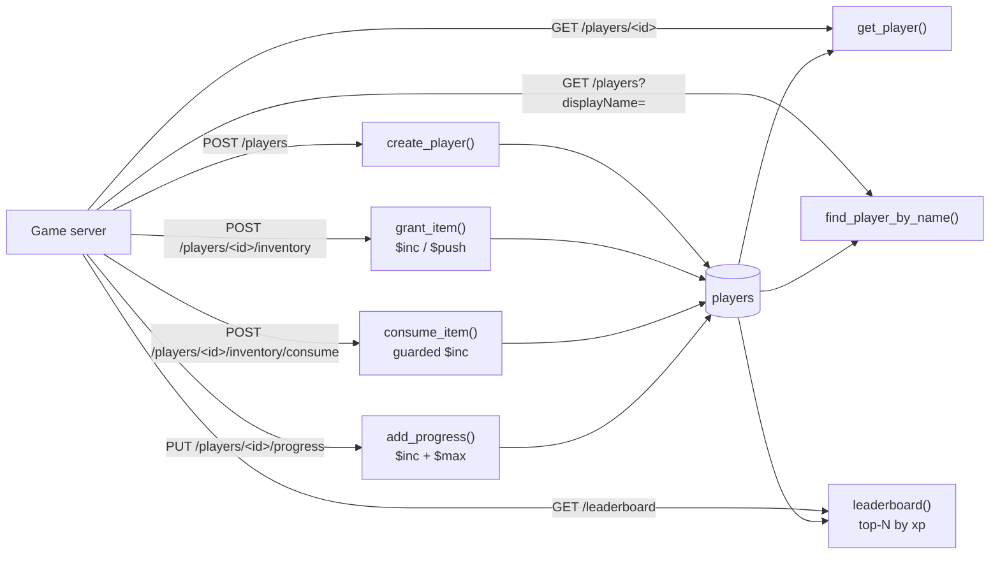

# Player Profile & Inventory

## Overview

A minimal example of modeling a player profile and inventory document on [Amazon DocumentDB](https://docs.aws.amazon.com/documentdb/latest/devguide/what-is.html) using Python and Flask. Each player's profile, nested inventory, progression counters, and per-title settings live in a single flexible document.

The document model fits when the player record is rich and nested, the schema evolves per title, and you need secondary indexes on several fields (here, display name and xp).

> **Scope.** All data is fictional and the sample has no authentication. The grant, consume, and progress endpoints are meant to be called by a trusted game server, not by game clients.

**Key design elements**

- One document per player with a flexible, per-title schema
- Existing inventory stacks are incremented in place with the positional `$` operator; new stacks are appended only if the item is absent, and the number of stacks is capped at 100 (bounded document)
- Each grant carries a `grantId`; recent IDs are remembered in a capped array, so a client retry does not grant twice
- `qty >= requested` check is part of the update filter, so concurrent requests cannot drive a stack negative; emptied stacks are then removed with `$pull`
- `xp` is awarded with `$inc`; `level` is computed from `xp` on the server and written with `$max`, so it never decreases under concurrent awards
- Bounded top-N leaderboard served by an index on `xp`
- Indexes that each back a query the code actually issues

### How the data flows



## Document Schema

```json
{
  "playerId": "p-1042",
  "displayName": "NovaStrike",
  "xp": 36400,
  "level": 37,
  "inventory": [
    { "item": "plasma_rifle", "rarity": "epic", "qty": 1 },
    { "item": "med_kit", "rarity": "common", "qty": 5 }
  ],
  "achievements": [ "first_blood", "survivor_100" ],
  "settings": { "region": "us-east", "crossplay": true },
  "recentGrantIds": [ "grant-8841" ]
}
```

`level` is derived (`1 + xp // 1000` in this sample). `recentGrantIds` is internal bookkeeping for retry-safe grants and is not returned by the API.

## API Endpoints

| Method | Path | Description |
| --- | --- | --- |
| `POST` | `/players` | Create a player profile (`playerId` and `displayName` required; optional `xp`, `achievements`, `settings`; `level` is derived and inventory starts empty; `400` if the `playerId` or `displayName` exists) |
| `GET` | `/players/<playerId>` | Load a player document (Player 360) |
| `GET` | `/players?displayName=<name>` | Look up a player by unique display name |
| `GET` | `/leaderboard?limit=10` | Top-N players by `xp` (max 100) |
| `POST` | `/players/<playerId>/inventory` | Grant an item (`item`, `grantId`, optional `qty`, `rarity`); retry-safe |
| `POST` | `/players/<playerId>/inventory/consume` | Consume `qty` of an item; fails with `409` if insufficient |
| `PUT` | `/players/<playerId>/progress` | Award `xp` (1 to 10000); returns the new `xp` and derived `level` |

## Prerequisites

- Python 3.10+
- Amazon DocumentDB cluster
- Amazon DocumentDB CA certificate:

```bash
wget https://truststore.pki.rds.amazonaws.com/global/global-bundle.pem
```

## Installation

```bash
pip install -r requirements.txt
```

## Configuration

Set the following environment variable before running:

| Variable | Required | Default | Description |
| --- | --- | --- | --- |
| `DOCDB_URI` | Y | — | Cluster connection string from the Amazon DocumentDB console (includes host, port, credentials, TLS, and read preference) |
| `FLASK_HOST` | N | `127.0.0.1` | Interface to bind. Leave as is unless you add authentication |
| `FLASK_DEBUG` | N | `0` | `1` enables the Flask debugger (local development only) |
| `SEED_COUNT` | N | `2000` | Total players after first-run seeding (hand-written plus generated) |

**Linux/macOS:**

```bash
export DOCDB_URI="mongodb://<user>:<pass>@your-cluster.cluster-xxxx.us-east-1.docdb.amazonaws.com:27017/?tls=true&tlsCAFile=global-bundle.pem&replicaSet=rs0&readPreference=secondaryPreferred&retryWrites=false"
```

**Windows PowerShell:**

```powershell
$env:DOCDB_URI="mongodb://<user>:<pass>@your-cluster.cluster-xxxx.us-east-1.docdb.amazonaws.com:27017/?tls=true&tlsCAFile=global-bundle.pem&replicaSet=rs0&readPreference=secondaryPreferred&retryWrites=false"
```

> Environment variables are convenient for a sample but are not how credentials should be handled in production. Use [AWS Secrets Manager](https://docs.aws.amazon.com/documentdb/latest/developerguide/docdb-secrets-manager.html) and load the connection details at startup.

## Running the Sample

```bash
python app.py
```

On first run the app creates indexes and, if the collection is empty, loads the hand-written records in `seed_data.json` and then generates additional sample players up to `SEED_COUNT` in total, then serves on `http://127.0.0.1:5000`. Generated data comes from a fixed PRNG seed, so every run produces identical data, and it gives indexes, and bounded queries realistic volumes to work against.

**Expected output:**

```
[INFO] __main__ – Connected to DocumentDB
[INFO] __main__ – Indexes ensured on collection 'players'.
[INFO] __main__ – Inserted 2000 sample documents
[INFO] __main__ – Starting web interface on http://127.0.0.1:5000
```

### Try it

```bash
# Load a player
curl -s http://127.0.0.1:5000/players/p-1042 | python -m json.tool

# Grant 3 med kits. Send it twice: the second call returns "duplicate": true
curl -s -X POST http://127.0.0.1:5000/players/p-1042/inventory \
  -H "Content-Type: application/json" -d '{"item":"med_kit","qty":3,"grantId":"grant-0001"}'

# Consume 2 med kits (409 if the player does not have enough)
curl -s -X POST http://127.0.0.1:5000/players/p-1042/inventory/consume \
  -H "Content-Type: application/json" -d '{"item":"med_kit","qty":2}'

# Award xp. The response includes the server-derived level
curl -s -X PUT http://127.0.0.1:5000/players/p-2087/progress \
  -H "Content-Type: application/json" -d '{"xp":1500}'

# Top 3 by xp
curl -s "http://127.0.0.1:5000/leaderboard?limit=3" | python -m json.tool
```

## Cleanup

```bash
python app.py --cleanup
```

Drops the `players` collection.

## Code Structure

```
.
├── app.py              # Flask application + DocumentDB access
├── seed_data.json      # Hand-written sample documents (more are generated on first run)
├── requirements.txt    # Python dependencies
├── .gitignore          # Ignored files
├── LICENSE             # License
└── README.md           # This file
```

## Anti-Patterns to Avoid

| Anti-Pattern | Why It's Harmful | Correct Approach |
| --- | --- | --- |
| `tlsAllowInvalidCertificates=True` | Disables certificate validation; exposes to MITM attacks | Always validate against the CA bundle (`tlsCAFile`) |
| Hardcoded credentials | Breaks rotation; leaks via source control | Environment variables for demos, Secrets Manager for production |
| Client-supplied `level` or `xp` deltas | Cheating, and inconsistent level and xp | Award xp from the authoritative game server; derive level from xp |
| Read-modify-write on xp or quantities | Lost updates under concurrency | Use atomic `$inc`, with the guard in the filter |
| `$push` for stackable items | Duplicate entries for the same item | Increment the existing stack with the positional `$` operator |
| Non-idempotent grants | A client retry after a timeout grants twice | Require a `grantId` and remember recent IDs |
| Unbounded `inventory` array | Document grows without limit | Cap stacks; move very large collections to their own collection |
| Global rank queries on a large collection | Counting documents ahead of a player scales with player count | Use a sorted-set store for rank at scale |

## Resources

- [Amazon DocumentDB Developer Guide](https://docs.aws.amazon.com/documentdb/latest/developerguide/what-is.html)
- [DocumentDB indexing and query best practices](https://docs.aws.amazon.com/documentdb/latest/developerguide/best-practices.html)
- [AWS Well-Architected Framework](https://aws.amazon.com/architecture/well-architected/)

## Disclaimer

This sample is provided for demonstration purposes and is not intended for production use as-is. Review the security, networking, and operational configuration against your own requirements before deploying.
